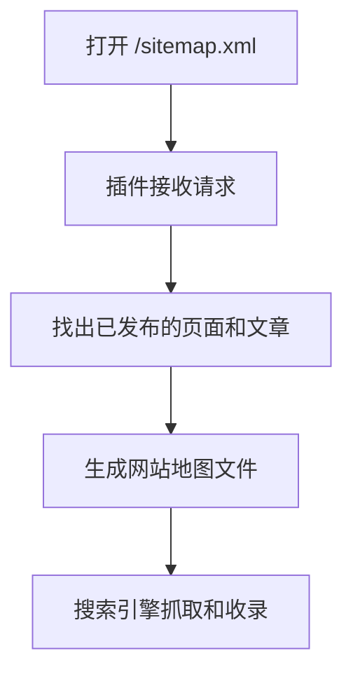
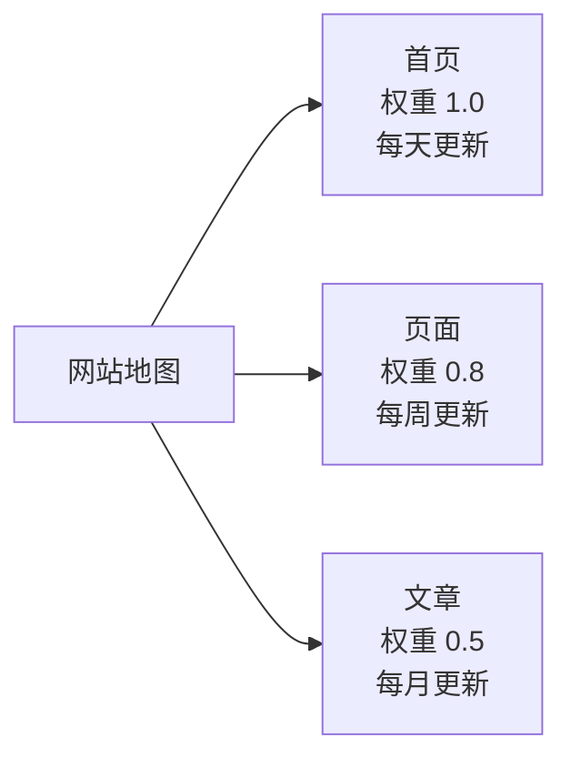

# Sitemap 网站地图生成器

给博客生成网站地图的插件，启用后，打开 `网站地址/sitemap.xml` 就能拿到整站的地图，方便搜索引擎抓取和收录。

> ⚠️ 只适用于 Typecho，不兼容 WordPress
>
> 这个插件是专门给 Typecho 写的，用的是 Typecho 的插件接口、路由和数据库。WordPress 兼容目前没有做，不要把它装到 WordPress 上，装了也用不了。
> 如果你用的是 WordPress，请不要下载这个插件，等以后真的做了 WordPress 版再用。

## 它是怎么工作的

## 地图里有什么

| 包括什么 | 权重 | 更新频率 | 说明 |
| --- | --- | --- | --- |
| 首页 | 1.0 | 每天 | 网站的首页，只有一条 |
| 已发布页面 | 0.8 | 每周 | 博客里已发布的独立页面 |
| 已发布文章 | 0.5 | 每月 | 博客里已发布的文章 |

还做了这几件小事，让地图更干净：

- 找不到路线的链接直接跳过，不输出无效链接
- 同一个链接只出现一次，不重复
- 链接做了转义，带特殊符号也不会把地图文件弄坏

## 安装

1. 下载这个仓库
2. 把插件文件夹放到网站目录下的 `usr/plugins/Sitemap`
3. 去博客后台，插件，启用 Sitemap
4. 打开 `网站地址/sitemap.xml`，确认能正常显示

## 适用和不适用

适用：

- Typecho 博客，能按上面步骤装插件的网站

不适用：

- WordPress：兼容没有做，装了用不了
- 其他博客系统、静态网站：插件用的是 Typecho 的接口，换系统就用不了

## 常见问题

**能不能用在 WordPress 上？**
不能。只给 Typecho 用，WordPress 版目前没有做。

**装完打不开 sitemap.xml 怎么办？**
先确认三件事：插件是不是已经启用了，文件夹是不是放在 `usr/plugins/Sitemap`，网站地址后面是不是加了 `/sitemap.xml`。这三件都对了还打不开，再把你看到的提示截图发过来。

**地图里为什么没有草稿和没发布的文章？**
这是故意只放已发布的，草稿和没到发布时间的文章不会出现在地图里，搜索引擎也抓不到它们。

## 反馈

用的时候遇到问题，可以在仓库提问题，写清楚这三点，方便定位：

1. 你的博客系统和版本，是 Typecho 还是别的
2. 插件版本，现在主线是 1.2.0
3. 打开 `sitemap.xml` 时看到的提示，或者截图

目前仓库里还没有公开的问题反馈，所以上面这些问题都是按大家最容易问错的地方先写清楚的，特别是 WordPress 兼容这一点。

## 版本记录

### 1.2.0（2026-11-04）

- 加了首页，权重最高
- 跳过找不到路线的链接，不再输出无效链接
- 同一个链接只出现一次
- 链接做了转义，防止带特殊符号时把地图文件弄坏
- 更新频率改得更真实：页面每周，文章每月，原来是全部写一直变
- 说明文件重写

### 1.1.1（原版本）

- 修改自 hanny 版本，由 @白先生 部分优化重构
- 支持生成网站地图

原说明参考：

- 主页内容：https://www.baixiaomo360.com/9
- 最终演示：https://www.baixiaomo360.com/sitemap.xml
